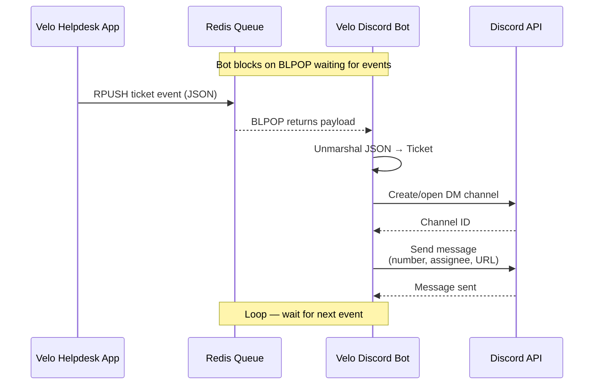
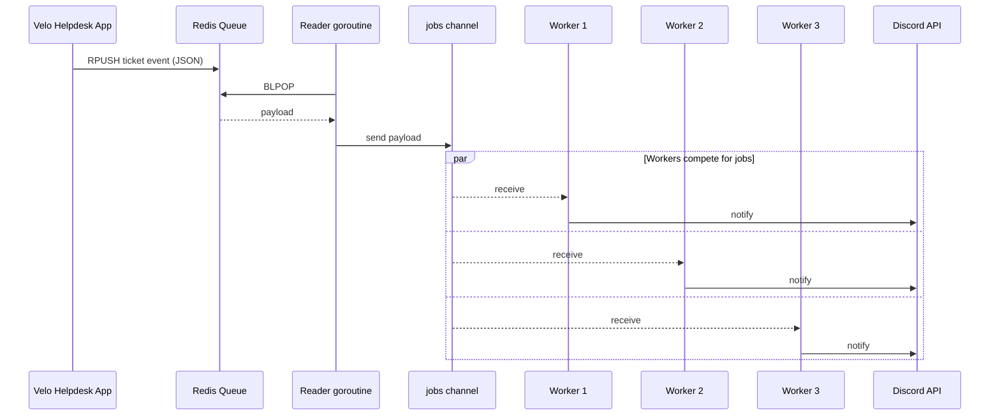

# Velo Discord Bot

Go Discord bot that consumes ticket events from a Redis queue and notifies assignees in Discord. Built as a side service for the main Velo helpdesk app.

## How it works

1. The main app pushes ticket events onto a Redis list (queue).
2. This bot blocks on `BLPOP`, waiting for the next event.
3. It unmarshals the payload into a `Ticket` and sends a Discord DM/channel message with ticket number, assignee, and URL.



## Stack

| Piece    | Choice                                                  |
| -------- | ------------------------------------------------------- |
| Language | Go 1.26                                                 |
| Discord  | [discordgo](https://github.com/bwmarrin/discordgo)      |
| Queue    | Redis (`go-redis`)                                      |
| Config   | `.env` via [godotenv](https://github.com/joho/godotenv) |

## Project layout

```
cmd/velo-bot/     # entrypoint
bot/              # Discord session + queue consumer
redis-connection/ # Redis client (push/pop helpers)
types/            # Ticket event payload
```

## Ticket payload

Events on the queue are JSON matching:

```json
{
  "ticket_id": "...",
  "ticket_number": "...",
  "ticket_url": "...",
  "ticket_assignee": "...",
  "discord_id": "..."
}
```

## Setup

**Requirements:** Go 1.26+, Redis, a Discord bot token.

1. Clone and install deps:

```bash
git clone https://github.com/Samswrld02/Velo-Discord-Bot.git
cd Velo-Discord-Bot
go mod download
```

2. Create a `.env` (gitignored):

```env
DISCORD_BOT_TOKEN=your_bot_token
REDIS_ADDR=localhost:6379
REDIS_PW=
REDIS_QUEUE=your_queue_name
```

3. Run:

```bash
go run ./cmd/velo-bot
```

## Planned concurrency

Today the bot reads Redis and handles Discord in one synchronous loop. The plan is to fan out work with a Go channel and a small worker pool (~3 workers):

1. One reader goroutine blocks on Redis `BLPOP` and sends each payload into a shared channel.
2. That channel is passed to workers; each worker does `for range` over the channel.
3. Workers unmarshal the ticket and send the Discord notification independently.



Rough shape:

```go
jobs := make(chan []byte) // or chan types.Ticket

// reader
go func() {
    for {
        jobs <- redis.ReadFromQueue(queue)
    }
}()

// workers
for i := 0; i < 3; i++ {
    go func() {
        for data := range jobs {
            handleTicket(data) // unmarshal + Discord send
        }
    }()
}
```

## Status

Early / WIP: queue consumer and basic ticket → Discord notification path are in place (still synchronous). Handlers/recipient resolution are partly hard-coded. Concurrent reader + channel + ~3 workers is planned (see above).
