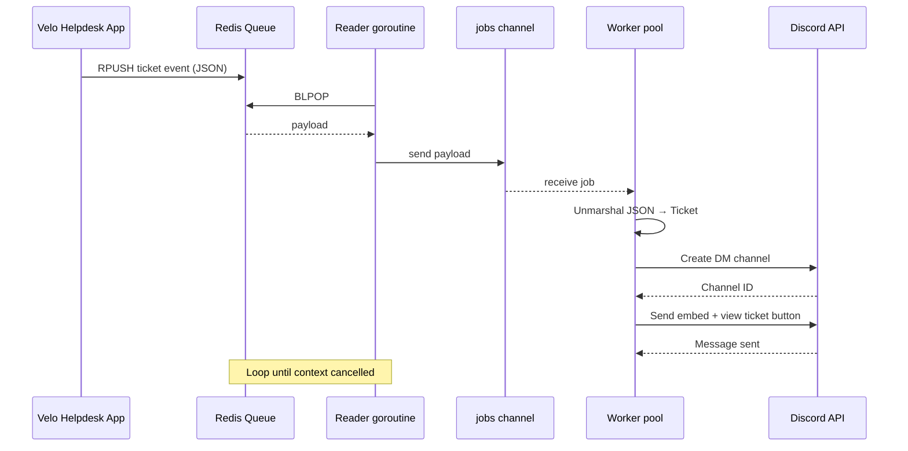

# Velo Discord Bot

Go Discord bot that consumes ticket events from a Redis queue and notifies assignees in Discord. Built as a side service for the main Velo helpdesk app.

## How it works

1. The main app pushes ticket events onto a Redis list (queue).
2. A reader goroutine blocks on `BLPOP`, waiting for the next event.
3. Each payload is sent into a shared jobs channel.
4. A pool of workers unmarshals the payload into a `Ticket` and switches on its `type`:
   - `ticket.assigned`: a DM (embed + link button) to the assignee.
   - `ticket.created`: a message in the channel that was linked with `/kanaal` (`channel_id`).



## Concurrency

The bot fans out work with a Go channel and a worker pool (5 workers):

1. One reader goroutine blocks on Redis `BLPOP` and sends each payload into a shared channel.
2. Workers `range` over that channel and handle Discord notifications independently.
3. On shutdown the channel is closed so workers drain and exit.

```go
eventChannel := make(chan []byte)

b.readEventWorker(eventChannel, r, ctx) // BLPOP → channel; close on ctx.Done()
b.handleTicketWorkers(5, eventChannel)

// readEventWorker
go func() {
    for {
        select {
        case <-ctx.Done():
            close(eventChannel)
            return
        default:
            value, err := r.ReadFromQueue(ctx, queue)
            // ...
            eventChannel <- value
        }
    }
}()

// handleTicketWorkers
for i := 0; i < workers; i++ {
    b.wg.Add(1)
    go func() {
        defer b.wg.Done()
        for job := range eventChannel {
            b.handleData(job) // unmarshal + Discord embed DM
        }
    }()
}
```

## Graceful shutdown

On `SIGINT` / `SIGTERM` the bot cancels its context, the reader closes the jobs channel, and it waits on a `WaitGroup` until in-flight workers finish before exiting.

## Stack

| Piece    | Choice                                                  |
| -------- | ------------------------------------------------------- |
| Language | Go 1.26                                                 |
| Discord  | [discordgo](https://github.com/bwmarrin/discordgo)      |
| Queue    | Redis (`go-redis`)                                      |
| Logging  | [logrus](https://github.com/sirupsen/logrus) (stdout + file) |
| Config   | `.env` via [godotenv](https://github.com/joho/godotenv) |

## Project layout

```
cmd/velo-bot/     # entrypoint
bot/              # Discord session, queue consumer, worker pool
redis-connection/ # Redis client (push/pop helpers)
types/            # Ticket payload + config
velo-api/         # HTTP client for the Velo backend (bot-token auth)
logger/           # logrus setup (writes to logger/logs/)
```

## Ticket payload

All events come through one list, `discord:events`. The `type` field decides what the bot does.

`ticket.assigned`:

```json
{
  "type": "ticket.assigned",
  "discord_user_id": "...",
  "ticket_id": "...",
  "ticket_number": "...",
  "subject": "...",
  "assigned_by": "...",
  "url": "...",
  "occured_at": "..."
}
```

`ticket.created` (one message per linked guild; `created_by` is `null` for tickets from e-mail):

```json
{
  "type": "ticket.created",
  "channel_id": "...",
  "ticket_id": "...",
  "ticket_number": "...",
  "subject": "...",
  "priority": "...",
  "channel_type": "...",
  "inbox": "...",
  "requester": "...",
  "created_by": "...",
  "url": "...",
  "occurred_at": "..."
}
```

## Slash command `/kanaal`

Links the channel you run it in to your Velo organization, so Velo knows where to post.

1. A member with **Manage Channels** runs `/kanaal` in the channel.
2. The bot defers an ephemeral reply (Discord wants an answer within 3 seconds).
3. It calls `POST /discord/guilds` on the Velo API with the guild, channel and Discord user id, authenticated with the `X-Velo-Bot-Token` header.
4. Velo checks the Discord account is linked to an admin and stores the channel; the bot shows Velo's (Dutch) message as-is.

The bot needs the `bot` **and** `applications.commands` scopes in its invite URL.

## Setup

**Requirements:** Go 1.26+, Redis, a Discord bot token.

1. Clone and install deps:

```bash
git clone https://github.com/Samswrld02/Velo-Discord-Bot.git
cd Velo-Discord-Bot
go mod download
```

2. Create a `.env` (gitignored):

```env
DISCORD_BOT_TOKEN=your_bot_token
REDIS_ADDR=localhost:6379
REDIS_PW=
REDIS_QUEUE=discord:events
REDIS_DB=2
VELO_API_URL=http://localhost/api/v1
VELO_BOT_TOKEN=same_value_as_DISCORD_BOT_API_TOKEN_in_velo_backend
DISCORD_DEV_GUILD_ID=    # optional: register commands instantly on one server while developing
```

3. Run:

```bash
go run ./cmd/velo-bot
```

## Status

Queue consumer, concurrent reader + worker pool, Discord embed notifications, structured logging, and graceful shutdown are in place. The `/kanaal` slash command links a channel to Velo.
